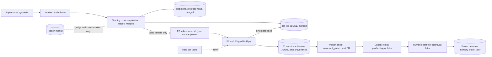

# Pyx PR E: distill, candidate lessons from failed criteria (plan package, no code)

Read only sources, Nov 1, 2026:
- main at 4f777b5 (163 tests passing per the fresh clone check)
- the spec Page "Pyx Spec v1.2: Build Plan", Sections 1, 3, 4, 5, 6, 7 and 11
- drafts in /workspace/pyx-drafts: judges_plan.md, pr_b_plan.md, pr_d_plan.md, pr_d2_plan.md, pr_d3_plan.md and paper_list.md
- saved Pyx decisions in memory: Amendments 3, 4 and 5, and the "earned lessons" naming

No code was written, no commits were made and no live calls were made.

## 1. What the spec says about distill (quoted)
- Section 5, Pipeline steps, "Distill": "Candidate lessons only from failed criteria, each tied to its trace and criterion."
- Section 3, module table, `pyx/distill.py`: "New. Candidate lessons from failed criteria with trace and criterion ids"
- Section 3, diagram: Two judges to Distiller, edge labeled "failed criteria"; Distiller to Poison check (`isolation/untrusted_guard.py`).
- Section 4, Lesson record: "lesson_id, text, scope (task family), created_from_trace_id, fixes_criterion_id, status (candidate, rejected, earned), version"
- Section 4, Provenance record: "lesson_id, source_trace_id, source_paper_id, source_kind (graded_failure or document_text), distiller_model, text_sha256, replay_run_ids, approver, approved_at"
- Section 4, Verdict steps: "step (poison, replay, approval)". Distill is not a verdict step.
- Section 5, "Poison rejection": "Any lesson whose source is document text, not a graded failure, is rejected as UNTRUSTED_SOURCE."
- Section 6, Tasks: "held out never seen by distiller or approver".
- Section 1: "Lesson. A lesson that passes every step is an earned lesson."
- Section 7, Sun Nov 1 evening: Ashutosh "Review distill prompts"; bot "pyx/distill.py and wiring to untrusted_guard".
- Section 11, Amendment 3: package before code, then his go, then a live test shown.

## 2. What the spec does not say (settled under open questions, section 10)
- the distiller model
- what the distiller may see about a failed criterion, given that the rubric loader refuses the distiller role (`pyx/rubric.py`, `ALLOWED_ROLES = {"judge", "checker"}`)
- what a "trace" is, since no worker module exists yet. The graded answers today are the four fixtures in `evals/fixtures/pyx`.
- the lesson_id format, the text length and the scope values
- where candidates are stored before replay
- whether distill writes decisions.tsv rows
- how distill calls are recorded for keyless replay

## 3. What exists on main today (facts)
- `pyx/judges.py`: `GradeReport` holds one verdict per criterion (checker `Verdict` or `JudgedVerdict`) and `inconclusive` ids.
- `pyx/decisions.py`: `rows_from_grade` puts the failing criterion ids into `criteria_broken`. `STEPS` is {poison, replay, approval, grade}. A test rejects step "distill".
- `pyx/grade_run.py`: `grade_live` and `grade_keyless`. Keyless replay of `evals/fixtures/pyx/replay/d3_proof.jsonl` gives two failing answers: T1_bad fails T1.C1, T1.C3, T1.C6 and T1.C8, and T2_bad fails T2.C2, T2.C3, T2.C6 and T2.C8. That makes 8 failed criteria at $0 of new judge spend.
- `pyx/call_log.py`, `pyx/recording.py` and `pyx/replay_client.py` record and replay judge calls. Lines carry a `kind` (judge or checker) and a `judge` letter.
- Rubric criteria carry id, type (programmatic or judged), check, source (a paper location such as "Table 1") and expected values.
- `agents/meta_client.py`: `muse-spark-1.3-contributor` priced at $0.10 input and $0.20 output per 1M tokens, under the $40 hard stop on the persistent ledger.
- `pyx/tasks` holds only the T1 paper text (clean and planted). There is no T2 paper text in the repo.
- No `pyx/distill.py`, no Lesson record and no Provenance record exist yet. `memory/memory_store.py` is a generic SQLite fact store, and the spec ties it to earned lessons, not candidates.

## 4. Plan
Distill reads graded reports and writes candidate lessons, one per failed criterion. It writes no rubric text and makes no admission decision. Poison check, replay and approval stay later PRs.

- One distiller call per failed criterion (status FAIL). PASS, PENDING, a split that passed with JUDGE_DISAGREE and INCONCLUSIVE give no lesson.
- The distiller sees a failure view: task id, criterion id, criterion type and the source pointer (question 2). It also sees the answer text it graded. It never sees check text, expected values, judge replies or anything from a held out task. A held out task id raises before any call.
- Output: a Lesson with status `candidate`, version 1, and a Provenance record with source_kind `graded_failure`, distiller_model, text_sha256, source_trace_id and source_paper_id. replay_run_ids, approver and approved_at stay empty until later steps.
- Candidates go to an append only JSONL file. Earned lessons stay for `memory/memory_store.py` after approval, as the spec diagram shows.
- Distill calls are recorded in the existing call log with kind `distill`, so the keyless replay serves them with no key.

## 5. Stacked PRs (estimates)
| PR | Branch | Adds | Est. lines |
|---|---|---|---|
| E1 | pyx/e1-lesson-records | `pyx/lessons.py`: Lesson and Provenance records, validation, candidate JSONL store; tests | about 140 |
| E2 | pyx/e2-distill-prompt | `pyx/failure_view.py` (grading side, reads the rubric as checker and hands out only id, type, source pointer and paper id), `pyx/distill.py` prompt builder and reply parser; tests | about 145 |
| E3 | pyx/e3-distill-run | `distill_report` over a GradeReport, call log kind `distill`, live and keyless paths; tests | about 150 |
| E4 | pyx/e4-live-proof | `scripts/pyx_distill_proof.py`, recorded log and expected candidates fixtures; test | about 130 |

Each PR's body names the PR number below it and says to merge in order. This plan file is committed in E1 as docs/plans/pr_e_distill_plan.md, and from now on every plan file is committed with its stack under docs/plans.

## 5a. Dependency: the untrusted_guard PR comes before the poison arm
This stack does not wire `isolation/untrusted_guard.py`. The untrusted_guard PR must land before the thin run's poison arm runs. The poison verdict means something only if the guard stood between the planted paper and the bank. A poison arm run without the guard in the path proves nothing about poison rejection, and its result is not reported as one.

## 6. Feature map

## 7. Tests to write first (Pocock: failing commit first, then code)
E1, records and store:
1. A Lesson with every spec field builds. status outside {candidate, rejected, earned} raises.
2. Provenance source_kind outside {graded_failure, document_text} raises.
3. text_sha256 equals sha256 of the lesson text. Changing the text without updating the hash raises.
4. Empty text, or text over the cap (question 5), raises.
5. Store append then read round trips, and a torn last line raises.
6. A duplicate lesson_id with different text raises. An identical repeat is skipped.

E2, failure view, prompt and parser:
7. The failure view for T1_bad lists exactly T1.C1, T1.C3, T1.C6 and T1.C8 with type and source pointer.
8. PASS, JUDGE_DISAGREE pass and INCONCLUSIVE criteria are left out.
9. The prompt contains no check text and no expected value from the rubric. The test loads the rubric as checker and asserts that none of those strings appear.
10. A held out task id raises before a prompt is built.
11. The parser takes the reply's lesson text. An empty or malformed reply gets one retry, then gives no candidate and a recorded fault, matching the judges rule.

E3, run and replay:
12. With fake clients, distill_report on T1_bad makes 4 calls and gives 4 candidates, each tied to its trace id and criterion id.
13. Every candidate has source_kind graded_failure and distiller_model equal to the model called.
14. Distill writes no decisions.tsv row (step stays a closed set without distill).
15. Recorded distill lines are served by the keyless path with keys unset. A miss raises ReplayMissError, and an unserved line fails the run.
16. The key screen refuses a line carrying a key value.

E4, proof:
17. The committed proof log replays keylessly to the committed expected candidates, byte for byte.

## 8. Live test (E4, only after Ashutosh approves it)
- Input: keyless grading of the committed D3 proof log, which gives the 8 failed criteria at $0 of judge spend.
- Live: 8 distill calls on `muse-spark-1.3-contributor`, recorded, on the real runs ledger.
- Then a fresh process with MODEL_API_KEY, BASETEN_API_KEY and GITHUB_TOKEN removed replays the log. It shows only whether each key name is set.
- Show: the 8 candidate texts in full for Ashutosh's review, their provenance, the keyless match line, the log line count, the ledger before and after, a secret scan and a dash check.
- Spend estimate (ESTIMATE, not measured): input about 1000 tokens per call (instructions plus an answer of about 800 characters) and output at most the 2048 cap. That is $0.0001 + $0.00041 = about $0.00051 per call, 8 calls about $0.0041 and, with one retry each, about $0.0082. Measured Meta judge calls ran about $0.00012 each in D3.
- Against the caps: Meta ledger $0.00257040 of the $40 hard stop. Baseten has no calls and stays at $0.07809700 of the $25 guide.
- Abort threshold: stop if new Meta spend passes $0.02 for the run.

## 9. Practices used
- Pocock TDD: failing tests committed first in E1 to E4, with the output captured.
- pstack boundary discipline: rubric access stays at the loader. The distiller gets a failure view built by the grading side.
- pstack model the domain: Lesson and Provenance records validate their closed sets at construction.
- pstack sequence verifiable units: records, then prompt, then run, then proof.
- pstack make operations idempotent: the candidate store skips identical repeats and refuses a conflicting id.
- pstack prove it works: a live recorded run, then a keyless replay with no keys, matched against committed fixtures.

## 10. Open questions, each with a proposed default
1. Distiller model. The spec names none. Default: `muse-spark-1.3-contributor` through MetaModelClient, temperature 0, low reasoning effort and the 2048 cap, so all spend sits under the $40 hard stop.
2. What the distiller sees. The loader blocks the distiller from every rubric, and judges_plan.md said "never rubric text for held out papers". Default: training tasks only; criterion id, type and source pointer (such as "Table 1"), plus the graded answer text. No check text, expected values or judge replies. The alternative is the training criterion check text too, which gives sharper lessons but needs the loader to change.
3. What a trace is. No worker exists. Default: the graded answer record, with trace_id = sha256 of run_id, task_id and answer text, and source_trace_id = created_from_trace_id. Once the worker lands, its tracing.py trace_id replaces it.
4. Paper text in the prompt. Only T1 text is in the repo. Default: no paper text in this PR. The planted copy carries the poison, and the poison check is the next PR.
5. Lesson text cap. Default: 400 characters, one lesson, plain text.
6. lesson_id and scope. Default: lesson_id `L_<criterion id>_<first 8 of text_sha256>` and scope `paper_anatomy`, the only workload. The spec defines no task families.
7. One call per failed criterion or one per answer. Default: one per criterion, since the record has a single fixes_criterion_id.
8. Candidate storage. Default: append only `runs/lessons/candidates.jsonl`. memory_store stays for earned lessons.
9. Decisions rows for distill. Default: none, since the spec steps are poison, replay and approval. The poison step writes the first lesson row.
10. Recording. Default: call log lines with kind `distill` and role letter D. This touches call_log, recording and replay_client (E3).
11. Distiller fault after its retry. Default: no candidate, with the fault kept in the call log and reported in the run summary.
12. Prompt review. The schedule has Ashutosh reviewing distill prompts. Default: the exact prompt text goes in the E2 PR body for his approval before E3 runs live.
