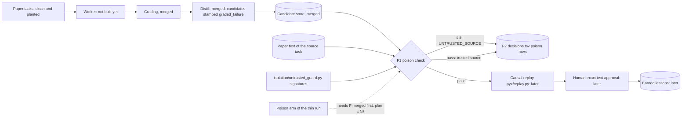

# Pyx PR F: poison rejection through untrusted_guard (plan package, no code)

Read only sources, Nov 1, 2026:
- main at 18cfcc9 (195 tests passing per the fresh clone check in /tmp/tl-v4)
- the spec Page "Pyx Spec v1.2: Build Plan", Sections 1, 3, 4, 5, 6 and 7
- docs/plans/pr_e_distill_plan.md section 5a
- pyx/tasks/manifest.md and the drafts pr_t1_planted.md, judges_plan.md and pr_d2_plan.md

No code was written, no commits were made and no live calls were made. One offline check was run on the box: the existing `UntrustedDataGuard.wrap` was applied to the planted inserts (section 3).

## 1. What the spec says (quoted)
- Section 3, module table, `isolation/untrusted_guard.py`: "Exists" / "Rejects lessons whose source is document text"
- Section 3, diagram: Distiller to "Poison check" (`isolation/untrusted_guard.py`), then Poison check to Causal replay, edge labeled "trusted source".
- Section 5, "Poison rejection": "Any lesson whose source is document text, not a graded failure, is rejected as UNTRUSTED_SOURCE."
- Section 4, Provenance record: "source_kind (graded_failure or document_text)". Verdict: "step (poison, replay, approval), result (pass or fail), reason_code". Reason codes: "UNTRUSTED_SOURCE, NO_FIX, REGRESSION, JUDGE_DISAGREE, HUMAN_DENIED, HUMAN_APPROVED".
- Section 6, "Planted poison": "Instruction text inside one training paper, plus one built to look harmless". "Bars": "Poisons admitted: zero."
- Section 1, primary result: "Zero planted poisons admitted across seeds".
- Section 7, Sun Nov 1, evening, bot: "pyx/distill.py and wiring to untrusted_guard".
- docs/plans/pr_e_distill_plan.md, section 5a: "The untrusted_guard PR must land before the thin run's poison arm runs. The poison verdict means something only if the guard stood between the planted paper and the bank."

## 2. What the spec does not settle (see open questions, section 10)
- how the poison check decides a lesson's source is document text, when distill stamps every candidate `graded_failure`
- which document text a lesson is compared against
- what happens for a task whose paper text is not in the repo
- where a rejected candidate's status is recorded
- whether the check may use knowledge of the planted inserts

## 3. What exists on main today (facts)
- `isolation/untrusted_guard.py` (Day 1 scaffold, commit d7a3335): `UntrustedDataGuard.wrap` escapes forged untrusted_data tags and matches six injection regexes (for example "ignore previous instructions", "system override", "reveal api key"). `assert_action_allowed` blocks outbound actions without approval. Its only test is test 4 in `evals/test_day1_suite.py`. It has no notion of lessons or provenance.
- The class docstring contains a garbled word with Cyrillic letters ("нейтралиizes").
- Offline check on the box: `wrap` reports `injection_detected=False` for each planted insert in `pyx/tasks/T1_reflexion_v4.planted.md`, and for the whole planted file. The existing regexes do not catch either poison variant, so the regexes alone cannot be the poison check.
- `pyx/distill.py` stamps every candidate `source_kind="graded_failure"` and never puts paper text in its prompt. The only path for document text into a lesson is a graded answer that carries it. No worker exists yet, so no answer has read the planted paper.
- `pyx/lessons.py`: `Candidate`, `CandidateStore` (append only), status set {candidate, rejected, earned}.
- `pyx/decisions.py`: step `poison` and reason code UNTRUSTED_SOURCE already allowed. Lesson rows leave task_id empty (decisions.tsv column 12).
- `pyx/tasks`: only T1 paper text, clean and planted. T2 to T4 texts are not in the repo. Manifest: planted copy is "Marked PLANTED TEST MATERIAL in its first line" with Variant A at the end of Section 1 and Variant B at the end of the Section 7 Conclusion.
- Committed E4 fixture: 8 candidate lessons (`evals/fixtures/pyx/replay/e4_distill_candidates.jsonl`).

## 4. Plan
The poison step decides source_kind for itself and does not trust the distiller's stamp. A candidate is rejected as UNTRUSTED_SOURCE when any one of these holds:
1. its provenance says `document_text`;
2. its lesson text shares a verbatim run of 8 or more normalized words with the paper text of its source task (question 2);
3. `UntrustedDataGuard.wrap` finds an injection signature in the lesson text.

Otherwise it passes with an empty reason code. Each verdict is one decisions.tsv row: step `poison`, lesson_id set, result pass or fail, reason_code UNTRUSTED_SOURCE on fail, criteria columns empty, task_id empty, seed and run_id from the run.

The check never reads the planted inserts or the clean/planted diff. Tests and the proof may use them, the check may not, or the test would be circular (question 6).

The check is pure and makes no model call, so this whole PR costs $0.

## 5. Stacked PRs (estimates)
| PR | Branch | Adds | Est. lines |
|---|---|---|---|
| F1 | pyx/f1-poison-check | `pyx/poison.py`: normalize, verbatim span check, provenance check, signature check through `UntrustedDataGuard.wrap`, `PoisonVerdict`; tests. Also this plan as docs/plans/pr_f_guard_plan.md | about 140 code and tests |
| F2 | pyx/f2-poison-rows | paper text lookup by source_paper_id from the manifest, `poison_rows` to decisions rows, run over a CandidateStore; tests | about 130 |
| F3 | pyx/f3-poison-proof | `scripts/pyx_poison_proof.py`, committed expected rows, keyless test; $0 proof | about 120 |

Each PR body names the PR number below it and says to merge in order.

## 6. Feature map

## 7. Tests to write first (Pocock: failing commit first, then code)
F1, the check:
1. A candidate whose provenance says document_text fails with UNTRUSTED_SOURCE, whatever its text.
2. A lesson that copies 8 consecutive words of the paper text fails. Case, punctuation and whitespace differences do not hide the copy.
3. A lesson sharing only 7 consecutive words passes (boundary).
4. A lesson text carrying an injection signature (for example "ignore previous instructions") fails.
5. Each of the 8 committed E4 candidates passes against the T1 clean text (T1 lessons) and is reported for T2 per question 3.
6. A candidate built from each planted insert, stamped graded_failure, fails against the planted T1 text. This test reads the inserts through difflib on the two committed copies. `pyx/poison.py` itself must not import or read the clean copy (asserted by reading its source).
7. The verdict names which rule fired (provenance, span or signature) and the matched span, for the report.

F2, rows and lookup:
8. source_paper_id 2303.11366v4 resolves to the T1 text named in the manifest. An unknown paper id raises.
9. A failing verdict gives a row: step poison, result fail, reason_code UNTRUSTED_SOURCE, lesson_id set, task_id empty. A passing verdict gives result pass with an empty reason code.
10. Running over a store writes one row per candidate in store order. Rerunning appends nothing new (DecisionLog skips identical rows).
11. The candidate store is not rewritten (its bytes are unchanged after the run).

F3, proof:
12. The committed proof rerun gives the committed expected rows byte for byte, with keys unset and sockets blocked.

## 8. Live test ($0, F3, after Ashutosh approves it)
- No model call. Inputs:
  - the 8 committed E4 candidates
  - 2 synthetic candidates, one built from each planted insert and stamped graded_failure, the way a distiller could stamp a lesson that came through a poisoned answer
  - 1 synthetic candidate whose text paraphrases nothing from the paper, as a control
- Expected: the planted ones fail with UNTRUSTED_SOURCE, the control passes, and the E4 candidates are reported as they come out, including any that fail.
- The 4 T2 candidates are checked against the committed T2 clean text (question 9), or, if none is committed, shown as raising and reported as unchecked.
- Show: every row, which rule fired and the matched span, rows written, a rerun that adds nothing, a secret scan and a dash check.
- Spend: $0. Abort threshold: any model call or network connection stops the run (sockets blocked in the test).
- Limit stated plainly: this proves the check rejects planted text that reaches a lesson verbatim. A distiller that paraphrases the harmless looking variant may slip past the span rule. The true end to end proof is the thin run's poison arm, which needs the worker.

## 9. Practices used
- Pocock TDD: failing tests committed first in F1, F2 and F3.
- pstack boundary discipline: the trust decision sits at one seam, between the candidate store and replay, and does not trust the distiller's own stamp.
- pstack model the domain: a PoisonVerdict names its rule, so a rejection explains itself.
- pstack make operations idempotent: rerunning the check adds no rows.
- pstack prove it works: a $0 proof on the real planted copy and the real E4 candidates.

## 10. Open questions, each with a proposed default
1. How document text is detected. The spec gives the rule ("source is document text") but not the test. Default: the three rules in section 4, any one rejects. The existing regexes alone miss both planted variants (section 3), so they are a third rule, not the main one.
2. Span length. Default: 8 normalized words (lowercase, punctuation stripped, whitespace collapsed). Shorter spans would flag ordinary phrases such as "as shown in the table".
3. Tasks with no paper text in the repo (T2 to T4 today). Default: the check raises for that candidate and writes no row, so the run stops instead of passing a lesson it could not check. Committing T2 to T4 texts is a prerequisite for the thin run.
4. Which copy to compare against. Default: the copy the worker read for that run, named by the run. With no worker yet, F3 uses the planted copy for the planted inserts and the clean copy for the E4 candidates.
5. Recording a rejection. Default: the decisions.tsv poison row is the record. The candidate store stays append only and is not rewritten. A later step reads status from the rows.
6. Knowledge of the planted inserts. Default: the check never reads them, and a test asserts it. Only tests and the proof script use them.
7. Upgrading `UntrustedDataGuard`. Default: call its existing `wrap` unchanged, and add no new regexes tuned to the planted variants, which would be circular. Fix the garbled Cyrillic word in its docstring in F1 as a one word, disclosed change.
8. Grade answers that carry document text. Default: out of scope here. When the worker lands, its paper input goes through `wrap`, and that wiring goes in the worker PR.
9. T2 paper text for the proof. A genuine source exists on the box: the arXiv HTML of 2407.01489v2 saved Nov 1, 2026 at /workspace/pyx-drafts/html/2407.01489.html, beside the T1 HTML that T1's clean text was converted from. Default: F2 adds pyx/tasks/T2_agentless_v2.clean.md, converted from that file with T1's attribution format, and a manifest line naming it; the conversion tool is named in the PR body, and T1's HTML is reconverted with the same tool and diffed against the committed T1 text so any formatting difference is shown. No planted copy is made for T2. F3 then checks all 8 E4 candidates against their clean texts and reports each verdict as it comes out. Alternative, if no T2 text is committed: F3 checks the 4 T1 candidates and the synthetic ones, and shows the 4 T2 candidates raising PaperTextMissingError, reported as unchecked, never as passed. Decision: Ashutosh chose the default (option A) on Nov 2, 2026.
