# Pyx PR G: the worker, paper anatomy answers on a Meta model (plan package, no code)

Read only sources, Nov 2, 2026:
- main at 41739aa (210 tests passing per the fresh clone check in /tmp/v22)
- the spec Page "Pyx Spec v1.2: Build Plan", Sections 1, 3, 4, 5, 6, 7, 8 and 11
- docs/plans/pr_e_distill_plan.md and docs/plans/pr_f_guard_plan.md
- pyx/tasks/manifest.md, the committed fixtures in evals/fixtures/pyx, and the modules cited below

No code was written, no commits were made and no live calls were made. The ledger figures in section 8 were given to me as the current persistent ledger; the per call costs come from the committed call logs.

## 1. What the spec says (quoted)
- Section 3, diagram: node "Worker", detail "agents/meta_client.py"; edges Paper tasks to Worker, Worker to Two judges, and Earned lessons to Worker labeled "next day, held out" (dashed).
- Section 3, module table, `agents/meta_client.py`: "Exists, updated" / "Worker and Judge A calls on `muse-spark-1.3-contributor`; spend ledger".
- Section 3, module table, `agents/tracing.py`: "Exists" / "Spans for every call".
- Section 3, module table, `pyx/run.py`: "New" / "CLI: wake, grade, distill, admit, held out".
- Section 5, "Hidden rubric": "stored in pyx/tasks and never shown to the worker."
- Section 5, "Work": "Worker writes the paper anatomy on `muse-spark-1.3-contributor`."
- Section 5, "Next day held out": "Rerun held out papers with all earned lessons in context (Amendment 4) and compare arms."
- Section 6, "Arms": "No memory; raw traces in context; free lessons (no checks); earned lessons (full chain)". "Seeds": "3". "Planted poison": "Instruction text inside one training paper, plus one built to look harmless". "Log": "decisions.tsv for every grade and verdict; raw JSONL traces". "Bars": "Poisons admitted: zero."
- Section 7, Sun Nov 1 evening, bot: "thin end to end run on 2 train and 2 held out papers". Mon Nov 2 afternoon, bot: "All four arms; code freeze at 6 PM".
- Section 8, "Hard stop": "$40 Meta spend, enforced in meta_client.py (default cap now 40.00)".
- Section 11, Amendment 4: "For Horizon 0 the worker gets all earned lessons in context, with no BM25 and no filter ... the form stays symmetric with the raw traces arm, differing only in content."
- docs/plans/pr_e_distill_plan.md section 5a: "The untrusted_guard PR must land before the thin run's poison arm runs."
- docs/plans/pr_f_guard_plan.md question 8: "When the worker lands, its paper input goes through `wrap`, and that wiring goes in the worker PR."

## 2. What the spec does not settle (see open questions, section 10)
- the worker prompt: what "paper anatomy" asks for, and the answer length
- how the four arms reach the worker, and what "raw traces in context" holds
- what the "poison arm" is; Section 6 names four memory arms and none is a poison arm
- what a seed means at temperature 0
- the 2 held out papers of the thin run, when manifest.md says "Held out paper texts and rubrics are not stored in this repo"
- whether `agents/tracing.py` sits in the runtime path
- how two candidate lessons that contradict each other reach the worker in the free lessons arm

## 3. What exists on main today (facts)
- `agents/meta_client.py`: `DEFAULT_MODEL = "muse-spark-1.3-contributor"` (line 94); pricing $0.10 input and $0.20 output per 1M tokens (lines 77 to 82); `respond` takes prompt, role, model, reasoning_effort, max_output_tokens, temperature (lines 209 to 218); before each call it projects cost from `len(prompt) // 4` input tokens plus the full output cap and checks the persistent ledger against the cap (lines 230 to 236, 175 to 186).
- `agents/spend_ledger.py`: persistent per provider ledger; recording a call id twice is a no op; atomic replace under flock (module docstring, lines 1 to 9).
- `pyx/rubric.py` line 11: `ALLOWED_ROLES = frozenset({"judge", "checker"})`. A worker role cannot load a rubric today.
- `pyx/judges.py` lines 30 to 32 and 79 to 89: Judge A calls `respond` with role eval-runner, reasoning effort low, 2048 cap, temperature 0.
- `pyx/grade_run.py`: `grade_live` (lines 40 to 54) and `grade_keyless` (lines 73 to 88) take `Answers = Sequence[Tuple[str, str]]`, task_id and answer_text (line 29). The worker's output has to be exactly this shape to feed grading unchanged.
- `pyx/call_log.py` lines 89 to 99: every model call line carries kind, a role letter, model, endpoint, params, replay key, prompt_sha256 and the full prompt unless held_out, in which case the prompt is stored as null. Lines 49 to 55 screen every line for key values.
- `pyx/recording.py` line 25 and `pyx/replay_client.py` line 40: both already take a `kind` and a role letter, so a new kind needs no change there. ReplayClient raises ReplayMissError on a miss (lines 45 to 57) and reports unused lines (lines 65 to 66).
- `pyx/distill.py` lines 68 to 69: `trace_id(run_id, task_id, answer_text)` is sha256 of those three. Distill plan question 3: "Once the worker lands, its tracing.py trace_id replaces it."
- `pyx/poison_run.py` line 21: `COPIES = frozenset({"clean", "planted"})`; `paper_text(paper_id, copy)` (lines 33 to 42) resolves a manifest paper id to its committed text and raises `PaperTextMissingError` when absent.
- `isolation/untrusted_guard.py` lines 40 to 62: `wrap(raw_text, source)` escapes forged untrusted_data tags and returns `wrapped_text` inside an untrusted_data envelope.
- `agents/tracing.py` line 32: `TraceCollector` reads `PHOENIX_COLLECTOR_ENDPOINT`, default `http://localhost:6006/v1/traces`.
- `pyx/tasks`: T1 clean (60023 bytes), T1 planted (60899 bytes), T2 clean (99510 bytes). No T3, T4 or held out texts (manifest.md).
- Committed answers: four fixtures in evals/fixtures/pyx (T1_good, T1_bad, T2_good, T2_bad), 733 to 839 bytes each. These are hand written, not worker output.
- Committed E4 candidates (`evals/fixtures/pyx/replay/e4_distill_candidates.jsonl`): 8 lessons, line 1 `L_T1.C1_59c8ef44` and line 6 `L_T2.C3_33cfe628`.
- No `pyx/worker.py`, no answer store and no `pyx/run.py` exist.

## 4. Plan
The worker turns one paper text into one paper anatomy answer with one Meta call, and nothing else. It is the first stage of the thin run; the arms, the run CLI and the report stay later packages.

- Input: task_id, copy (clean or planted, reusing `poison_run.COPIES` and `paper_text`), run_id, seed, arm, and a context block of lessons or traces (empty for the no memory arm).
- The paper text goes through `UntrustedDataGuard.wrap` before it enters the prompt (guard plan question 8). The context block is built by the caller, so the four arms differ only in content, as Amendment 4 requires. The worker never loads a rubric; a test proves `load_rubric(..., role="worker")` still raises.
- Model: `muse-spark-1.3-contributor` through `MetaModelClient.respond`, temperature 0, reasoning effort low, 2048 output cap, the same settings Judge A uses. No other model may be passed; a non Meta model id raises before any call.
- Output: an `Answer` record (run_id, seed, arm, task_id, copy, answer_text, trace_id, model, lesson_ids in context) stored in an append only JSONL answer store. trace_id stays `pyx.distill.trace_id` so provenance keeps working.
- Recording: call log lines with kind `worker` and role letter W. The keyless path builds a `ReplayClient(lines, judge="W", kind="worker")` and fails on a miss or an unused line, the same rule as grading.
- Handoff: `answers_for_grading(store, run_id)` returns `[(task_id, answer_text)]` in store order, which `grade_live` and `grade_keyless` take unchanged.
- Faults: an empty reply gets one retry, then no answer and a recorded fault (the judges rule for a malformed reply, `pyx/judges.py` lines 91 to 108). `BudgetCapExceededError` is never caught.

## 5. Stacked PRs (estimates)
| PR | Branch | Adds | Est. lines |
|---|---|---|---|
| G1 | pyx/g1-worker-prompt | `pyx/worker.py`: `Answer` record, model guard, `build_worker_prompt` with the guard wrapped paper text and the context block, reply parser; tests. Also this plan as docs/plans/pr_g_worker_plan.md | about 140 code and tests |
| G2 | pyx/g2-worker-run | answer store (append only, idempotent), `work_live` and `work_keyless` with kind worker and letter W, `answers_for_grading`; tests | about 150 |
| G3 | pyx/g3-worker-proof | `scripts/pyx_worker_proof.py`, recorded call log and expected answers fixtures, keyless test that also grades the replayed answers through `grade_keyless` | about 130 code and tests |

Overage disclosed: G1 also carries this plan file (148 lines of markdown), outside the code count, as F1 did. G3's recorded log holds the full prompts, so its fixture is about 220 KB in 3 lines plus the grading lines (question 7). Each PR body names the PR below it and says to merge in order.

## 6. Feature map

```mermaid
flowchart LR
  T[(pyx/tasks: T1 clean, T1 planted, T2 clean)] -->|paper_text, merged| UG[untrusted_guard.wrap, merged]
  CX[Context block from the arm: later] --> P[G1 build_worker_prompt]
  UG --> P
  P --> W[G2 worker call: muse-spark-1.3-contributor only]
  W -->|kind worker, letter W| CL[(call log JSONL, merged)]
  CL -->|keyless| RW[G2 ReplayClient W]
  W --> AS[(G2 answer store)]
  RW --> AS
  AS -->|task_id, answer_text| G[Grading: checker plus two judges, merged]
  G --> DT[(decisions.tsv, merged)]
  G -->|failed criteria| D[Distill, merged]
  D --> PC{Poison check, merged}
  PC --> RP[Causal replay: later, reruns the worker]
  RP --> H[Human approval: later]
  H --> B[(Earned lessons: later)]
  B -.->|Amendment 4, all in context| CX
  R[(Hidden rubrics)] -.->|never| P
  PA[Thin run poison arm: later] -.->|copy planted| T
```

## 7. Tests to write first (Pocock: failing commit first, then code)
G1, prompt and record:
1. The prompt for T1 clean contains the paper text inside one untrusted_data envelope from `wrap`, and a forged closing tag in the paper comes out escaped.
2. The prompt contains no rubric check text and no expected value. The test loads T1 and T2 rubrics as checker and asserts none of those strings appear.
3. `load_rubric("T1", role="worker")` raises (proves the boundary stays shut).
4. The context block appears verbatim in its own marked section; an empty block leaves the prompt identical to the no memory form apart from that section.
5. A model id other than `muse-spark-1.3-contributor` raises before any client call.
6. A held out task id with no committed text raises `PaperTextMissingError` before any call.
7. The parser returns the reply text; an empty reply is a fault.

G2, run, store and replay:
8. With a fake client, `work_live` on T1 clean makes 1 call with temperature 0, reasoning effort low and cap 2048, and stores 1 Answer whose trace_id equals `pyx.distill.trace_id(run_id, task_id, answer_text)`.
9. A rerun with the same run_id, seed, arm, task_id and copy makes no call and appends nothing; the same key with different text raises.
10. Recorded worker lines are served by `work_keyless` with keys unset; a miss raises ReplayMissError and an unused line fails the run.
11. An empty reply retries once, then records a fault and stores no answer; `BudgetCapExceededError` propagates.
12. `answers_for_grading` returns `(task_id, answer_text)` pairs in store order, accepted by `grade_keyless` on a fake log.
12a. Recorded and keyless worker runs, in a fresh process with `PHOENIX_COLLECTOR_ENDPOINT` unset and sockets blocked, never import `agents.tracing` (asserted on `sys.modules`) and open no connection. G2 owns this proof.

G3, proof:
13. The committed proof log replays keylessly to the committed expected answers byte for byte, then `grade_keyless` on those answers reproduces the committed grade rows, with keys unset and sockets blocked.

## 8. Live test (G3, only after Ashutosh approves it)
- Calls: 3 worker calls, one seed, arm no memory: T1 clean, T1 planted, T2 clean. Then `grade_live` on the 3 answers: each rubric has 1 judged criterion (pyx/rubrics/T1.json and T2.json, 7 programmatic and 1 judged), so 3 Judge A and 3 Judge B calls.
- Then a fresh process with MODEL_API_KEY, BASETEN_API_KEY and GITHUB_TOKEN removed replays all of it. It shows only whether each key name is set.
- Acceptance: the live proof counts only after Ashutosh approves the exact worker prompt text in G1's PR body. If the prompt changes after that, the live proof reruns and is shown again.
- Show: the 3 answers in full, grade rows, the keyless match line, log line counts, the ledger before and after, a secret scan and a dash check. The T1 planted answer is shown with a check of whether either planted insert reached it verbatim (difflib on the two committed copies, test side only, as in F). Each answer also gets a truncation check: whether it ends mid table or mid sentence, and its output token count against the 2048 cap. If an answer is cut, the cap goes to the thin run package with that data.
- Spend estimate (ESTIMATE, not measured):
  - Worker input, using the client's own rule of bytes divided by 4: T1 clean about 15006 tokens, T1 planted about 15225, T2 about 24878. At $0.10 per 1M that is about $0.0015, $0.0015 and $0.0025. Output at most the 2048 cap at $0.20 per 1M, $0.00041 per call. Worker total at most about $0.0068, or $0.0136 if every call retries once.
  - Judge A, measured in d3_proof.jsonl: 4 calls, $0.0004842, about $0.00012 each; 3 calls about $0.00036.
  - Judge B, measured in d3_proof.jsonl: 4 calls, $0.01361975, about $0.0034 each; 3 calls about $0.0102.
  - Meta new spend about $0.0072 (at most $0.0140 with retries), taking the ledger from $0.00421380 to about $0.0114 of the $40 hard stop.
  - Baseten new spend about $0.0102, taking the ledger from $0.07809700 to about $0.0883 of the $25 guide.
- Abort threshold: stop if new Meta spend for the run passes $0.03 or new Baseten spend passes $0.05, or on any `BudgetCapExceededError`. A miss or unused line in the keyless rerun fails the proof.
- For the thin run package, not this one: by the same measured rates, each worker call on T1 or T2 costs at most about $0.0019 to $0.0029, so the call count of arms times tasks times seeds sets that package's estimate.

## 9. Practices used
- Pocock TDD: failing tests committed first in G1, G2 and G3, with raw failing then passing output.
- pstack boundary discipline: paper text is wrapped at one seam, the prompt builder; the rubric stays shut at the loader; the model guard sits at the call.
- pstack model the domain: an `Answer` names its run, seed, arm, task, copy and the lesson ids it saw, so every later step can trace an answer to its inputs.
- pstack make operations idempotent: the answer store skips identical repeats and refuses a conflicting key; the ledger already refuses double counting.
- pstack sequence verifiable units: prompt, then run and store, then proof, each mergeable alone.
- pstack fix root causes: grading runs on hand written fixtures today because no worker exists; G fixes that at the source instead of adding more fixtures.
- pstack prove it works: a live recorded run on the real papers, graded live, then a keyless replay with no keys matched byte for byte.

## 10. Open questions, each with a proposed default
1. What the worker is asked for. The spec says "paper anatomy" and the manifest names an architecture figure and results tables per paper. Default: the prompt asks for the architecture (components and their roles, from the named figure) and the quantitative results (from the named tables), the same two parts the distill prompt describes (`pyx/distill.py` line 35). It names the figure and tables from the manifest row and never the rubric. The exact prompt text goes in the G1 PR body for Ashutosh's approval. G3's live proof is accepted only after that approval, and any later prompt change reruns the proof (section 8).
2. Answer length. Default: the 2048 output cap only, no character cap, so a long table is not cut by a rule the rubric does not state.
3. How arms reach the worker. Default: the worker takes one opaque context block and the arm name; building each arm's block (empty, raw traces, all candidates, all earned lessons) belongs to the thin run package, so the worker cannot treat arms differently.
4. The poison arm. Section 6 lists four memory arms; "poison arm" comes from distill plan 5a. Default: the poison arm is the T1 planted copy run through worker, grading, distill and the merged poison check, scored against "Poisons admitted: zero"; it is a task copy, not a fifth memory arm. The worker supports it through `copy="planted"`.
5. Seeds at temperature 0. The spec says 3 seeds, the client has no seed parameter (`respond` signature, lines 209 to 218), and I have not checked whether the Meta API accepts one. Decided: the API offers no seed setting, so a seed means a repetition under a distinct run id, recorded as a label in the Answer and decisions.tsv. EVAL.md states this plainly, and the thin run reports whether replies differ across repetitions instead of claiming independent samples.
6. Held out papers for the thin run. Section 7 says 2 held out papers; the manifest says held out texts are not stored in the repo, and `paper_text` raises for them. Default: the worker plan does not resolve this; the thin run package proposes either committing H1 and H2 texts (CC BY 4.0 per the manifest) or running the thin run on T1 and T2 only and saying so.
7. Prompts in the call log. A worker prompt holds a whole paper, so G3's fixture is about 220 KB. Default: keep the full prompt as for judges (call_log.py line 96), because replay keys hash it and a reviewer can read what the model saw. Alternative: store only prompt_sha256 for worker lines, which shrinks the fixture but needs a call_log change.
8. Tracing. `agents/tracing.py` defaults to a localhost collector endpoint (line 32), and the keyless path must open no network. Default: no TraceCollector in the runtime path in this stack, owned by G2 and proved by test 12a; trace_id stays `pyx.distill.trace_id`, and the distill plan's "tracing.py trace_id replaces it" is deferred and disclosed.
9. Reasoning effort. Default: low, the Judge A setting (`pyx/judges.py` line 32), for cost and comparability. Alternative: medium for richer answers at higher output spend inside the same cap.
10. Lessons 1 and 6 conflict. `L_T1.C1_59c8ef44` says "never infer, round, combine, or compute derived differences from memory"; `L_T2.C3_33cfe628` says "recompute any claimed gain by subtracting the two relevant rows". In the free lessons arm both reach the worker together. Worker scope only: the worker passes whatever context block it receives through unchanged and records the lesson ids it saw. The rule for which lessons each arm carries belongs to the runner package, settled by replay evidence with Ashutosh's approval and frozen in EVAL.md.
11. Branch for G1 base. Default: G1 based on main at 41739aa, G2 on G1, G3 on G2.
