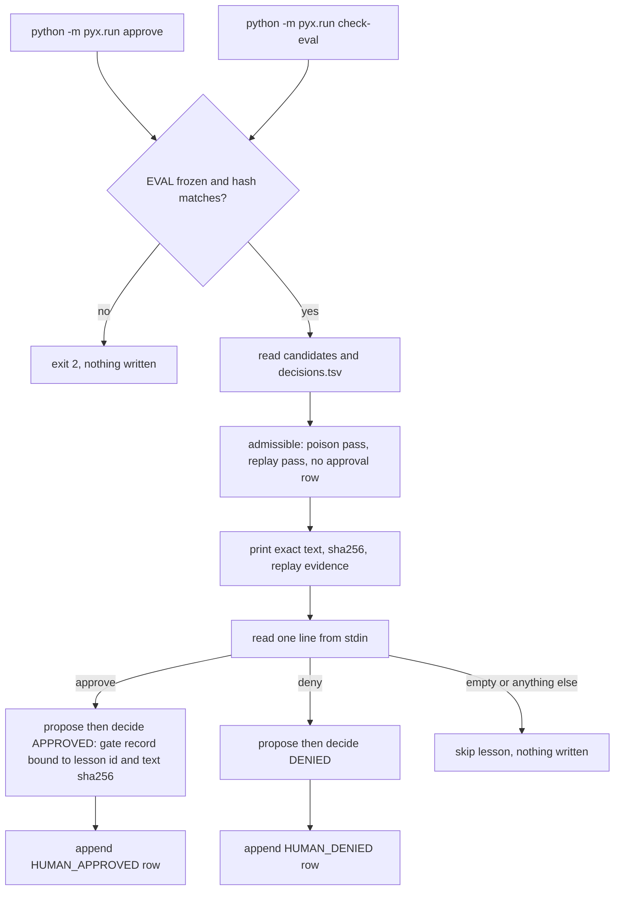

# Pyx H6: terminal approval CLI (plan)

Status: DRAFT plan. No code written, nothing pushed. Base: `pyx/h5-eval` (PR #31). Branch: `pyx/h6-cli`.

## 1. Why

The spec (Section 5, "Human approval") and the H plan (open question 11) name a terminal interface: `pyx/run.py approve` prints each lesson's exact text, its sha256 and replay evidence, and reads the decision typed by Ashutosh at his own keyboard. H4 shipped functions only. Without a committed entry, approvals in the live run would go through an improvised driver. This PR adds that entry before the EVAL freeze.

## 2. Scope

* `python -m pyx.run approve`: for each admissible candidate (poison pass and replay pass rows present, no approval row yet), print `approval_text` (exact lesson text, sha256, replay evidence), read one line from stdin, and call the existing `pyx.approval.propose` and `decide`.
* `python -m pyx.run check-eval`: print the EVAL.md sha256 and its status, exit 0 only when frozen and matching the expected hash. Proposed in: about 15 lines, and it gives Ashutosh one command to confirm the freeze before the thin run (open question 2).
* Out of scope: `wake` and `grade` subcommands (the live run needs its own go), any network call, any change to gate, approval, replay, or arms logic.

## 3. Map



## 4. Interface

```
python -m pyx.run approve --candidates PATH --decisions PATH --gate-db PATH --eval PATH --eval-sha256 HEX --run-id ID
python -m pyx.run check-eval --eval PATH --eval-sha256 HEX
```

* `main(argv, stdin, stdout) -> int`, so tests pass a `StringIO` for stdin and stdout and never touch the real terminal.
* `--gate-db` is a SQLite file, so the gate record and the denial lock survive across invocations (the in memory gate used in tests would lose them).
* decided_by is the fixed OWNER "Ashutosh"; the instruction id is `approve_{lesson_id}_{text_sha8}`, so a changed text gets a new id and a denied text stays locked.
* Exit codes: 0 done, 2 EVAL not frozen or hash mismatch, 3 bad input files.

## 5. Tests first (evals/test_pyx_cli.py)

All tests use temp files, `StringIO`, and the socket connect block from H4. Each is committed failing (expected: `ModuleNotFoundError` or `AttributeError: main`), then passing.

1. `approve` prints the exact lesson text and its sha256 for each admissible candidate, verbatim, before reading input.
2. Typed `approve` writes one HUMAN_APPROVED approval row; typed `deny` writes one HUMAN_DENIED row; case and surrounding whitespace are trimmed, nothing else is accepted.
3. Empty input, end of input, `yes`, `APPROVED ` with a typo, or any other text writes no row and no gate decision for that lesson, and the command says the lesson was skipped.
4. The gate record payload carries the lesson id and the text sha256 printed in test 1; a candidate whose text changed after propose raises TextMismatchError and writes nothing.
5. A denied lesson run again under the same instruction id writes nothing (DenialLockError surfaced as a skip with a message).
6. When EVAL.md is DRAFT or its hash does not match, `approve` exits 2 before printing any lesson and writes nothing.
7. Candidates without poison and replay pass rows are never shown.
8. `check-eval` exits 0 on a frozen matching file, 2 otherwise, and prints the actual sha256.
9. Source check: the CLI module imports no HTTP client and no `agents.tracing`.

## 6. EVAL freeze relevance

Approve refuses unless EVAL is frozen (test 6). Reason: the approval rows feed the earned arm of a counted run, and EVAL.md fixes the lesson 1 and 6 rule before replay. Consequence: Ashutosh freezes EVAL.md first, then approves. Open question 1 covers the alternative.

## 7. Size

Expected about 130 lines: tests about 75, `main` plus two subcommands about 55 in `pyx/run.py` (or a new `pyx/cli.py` if run.py would pass 200 lines; open question 4). If check-eval is dropped, about 115.

## 8. Practices

Pocock TDD (each test failing then passing, raw output captured), pstack principles: boundary discipline (parse stdin at the edge, the gate stays the single writer), make operations idempotent (rerun skips lessons that already have an approval row), prove it works.

## 9. Open questions with defaults

1. Freeze before approve. Default: approve refuses unless EVAL is frozen. Alternative: allow approve on a DRAFT EVAL but mark rows uncounted.
2. Include check-eval. Default: yes, about 15 lines.
3. Accepted words. The H plan says APPROVED or DENIED; the rider says approve or deny. Default: accept exactly `approve` and `deny`, case insensitive; update plan question 11 to match.
4. Where the CLI lives. Default: `main` in `pyx/run.py` so the named path `pyx/run.py approve` holds; move to `pyx/cli.py` only if run.py would pass 200 lines.
5. Gate database location. Default: `runs/approvals.sqlite`, git ignored, path printed at start.
6. Order and pacing. Default: one lesson at a time in lesson id order, with lessons 1 and 6 (`L_T1.C1_59c8ef44`, `L_T2.C3_33cfe628`) shown with a note pointing to the frozen EVAL rule.
7. Where it runs. Default: on Ashutosh's own machine from a clone; the bot never types a decision.
